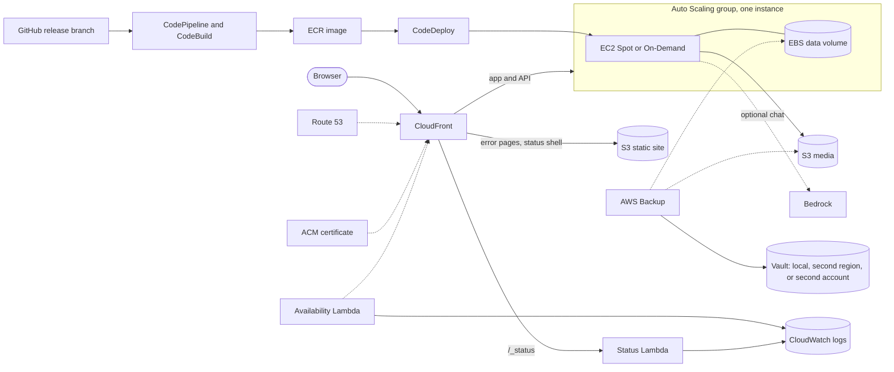

# Gramps Web on AWS

A Terraform module that runs [Gramps Web](https://www.grampsweb.org/), the web app for the Gramps genealogy program, on AWS for a few tens of dollars a month. It is an independent project, unofficial and not affiliated with or endorsed by the Gramps project.

The module serves one shape: a single instance with the database on SQLite on an EBS volume and media in S3. The instance is Spot or On-Demand, behind CloudFront, and backs up locally, to a second region, or to a second AWS account. Optional parts are an AI chat assistant on Amazon Bedrock and an operational [status page](docs/status-page.md). Gramps Web supports a single API replica, so there is no multi-instance mode.

Required inputs are `primary_domain`, `alert_email`, `repo_url`, and `source_branch`. Everything else has a default; the [module reference](#module-reference) lists them with their costs.


## Architecture



The availability Lambda probes the site every minute and records outages and their causes. The status Lambda reads that history, so the status page can show uptime and Spot reclaims.

## Cost

Real figures from one small production deployment, offered as an example and not a promise: a single Spot instance of about 4 GiB (module defaults are On-Demand, `spot.enabled` false), chat enabled, the status page on, and AWS Backup, in us-east-1, for one full month. Unblended cost by service from AWS Cost Explorer, in USD. The total includes the Tax row.

| Service | Sep 2026 |
|---|---:|
| EC2 compute (Spot) | 11.94 |
| Key Management Service | 4.96 |
| EC2 other (EBS and related) | 3.97 |
| VPC (public IPv4 address) | 3.61 |
| Tax | 2.83 |
| Container Registry (ECR) | 1.34 |
| CloudWatch | 1.30 |
| Route 53 | 1.04 |
| S3, Cost Explorer, CodeBuild, Backup | 0.51 |
| **Total** | **31.50** |

Everything else rounds to zero. No Bedrock line item appeared; chat is billed per token. The total is about one dollar a day. Spot prices, instance size, volume size, and chat usage move the total. Each cost-bearing input states its price in the [module reference](#module-reference).

The Route 53 line is the hosted zone from keel's `dns` module, and keel's audit module adds KMS keys, S3 storage, and CloudTrail to the KMS and S3 lines; this module's own keys are the data volume and backup keys.

## Backups

AWS Backup snapshots the data volume and the media bucket daily (`backup.schedule`). `backup.mode` picks where the recovery points go.

| Mode | Copy | Protects against |
|---|---|---|
| `local` | None. Recovery points stay in a vault in the same account and region. | Corruption, a bad upgrade, or accidental deletion of data. |
| `cross_region` | A second vault and key in `backup.region`. | Loss of the primary region. |
| `cross_account` | A vault owned by a separate AWS account (`backup.account_id`). | Loss or compromise of the workload account, including deletion of its backups. The destination vault can be locked so that nobody can delete recovery points. |
| `disabled` | No backups. | Nothing. |

Procedures: [cross-account backup](docs/cross-account-backup.md), [restore](docs/restore.md).

## Upgrading Gramps Web

Set `gramps.version` to the upstream image tag, apply, then deploy:

```hcl
gramps = {
  version = "26.10.2"
}
```

```sh
terraform apply
scripts/deploy.sh --root <root> gramps
```

The deploy builds the image from the upstream release plus your addons, pushes it to ECR, and rolls it out with CodeDeploy. Expect a brief interruption while the container swaps.

## Sleeping the site

`active = false` stops the instance and the canary alarms and keeps all data. Public IPv4, KMS keys, the Route 53 zone, ECR, and EBS keep billing, about ten to fifteen dollars a month on the table's figures (the zone and some KMS keys belong to keel in the example). Setting it back to `true` and applying wakes the site in about five minutes.

## Release branches

CodePipeline and CodeBuild pull `build/` and `scripts/` from `repo_url` on `source_branch`, and CodePipeline can source a branch but not a tag. Pin the module to a tag and set `source_branch` to the matching `release-<major>.<minor>` branch, which moves with patch releases:

```hcl
module "gramps_web" {
  source        = "git::https://github.com/kjiwa/terraform-aws-gramps-web.git?ref=v1.1.0"
  repo_url      = "https://github.com/<you>/terraform-aws-gramps-web"
  source_branch = "release-1.1"
  # ...
}
```

The builds run that branch's code with deploy permissions, so point `repo_url` at a repository you trust.

## Requirements

- Terraform 1.15 or later, the AWS provider 6.45 or later, and the archive (2.7 or later) and random (3.9 or later) providers. The module needs an `aws.us_east_1` provider alias for the CloudFront certificate.
- A public Route 53 hosted zone for each served domain. [terraform-aws-keel](https://github.com/kjiwa/terraform-aws-keel)'s `dns` module creates one.
- For the first deployment: Packer, to build the base AMIs, a default VPC in the region (Packer sets no subnet), and `aws`, `jq`, `curl`, `unzip`, and `sha256sum` for `build/ami/build.sh`.
- For the operator scripts under `scripts/`: the AWS CLI, `terraform`, and `jq`.
- For the AI assistant (`llm.enabled`): Anthropic model access enabled in the Bedrock console.

## Quickstart

[examples/minimal](examples/minimal) composes the module with keel's DNS, cost budget, and audit modules.

1. Fork this repository: GitHub's CodeConnections app installs only on accounts you control. In the module call, set `repo_url` to your fork and `source_branch` to the release branch matching the module ref (`release-<major>.<minor>`, see [Release branches](#release-branches)). The example takes both as variables, passed below with `-var`.

2. Build the base AMIs from a checkout of this repository. The module looks up the newest AMI tagged `Name=gramps-web-base`, so a plan fails until one exists; `ami_ids` stays unset. The build takes about ten minutes.

   ```sh
   REGION=us-east-1 build/ami/build.sh
   ```

   Use the region the site will run in; the example's `region` variable must match.

3. Create the GitHub connection.

   ```sh
   cd examples/minimal
   terraform init
   terraform apply -target=module.gramps_web.aws_codeconnections_connection.github \
     -var primary_domain=example.org -var alert_email=you@example.org \
     -var repo_url=https://github.com/<you>/terraform-aws-gramps-web -var source_branch=release-1.1
   ```

4. Approve it: in the console, open Developer Tools, Settings, Connections, update the pending `gramps-web` connection, and install the GitHub app on your fork.

5. Apply the rest.

   ```sh
   terraform apply -var primary_domain=example.org -var alert_email=you@example.org \
     -var repo_url=https://github.com/<you>/terraform-aws-gramps-web -var source_branch=release-1.1
   ```

   The first apply in a new account can fail while the Auto Scaling group launches its first instance ("Authentication Failure"); re-running the apply succeeded in testing. The status page at `/_status` is off by default: set `status = { enabled = true }` on the module after raising the account's Lambda concurrency quota (see the `status` input).

   The apply creates the hosted zone, then waits on certificate validation. Read the name servers with `terraform output -json name_servers` and set them at your registrar while it waits; re-running an apply that timed out is safe. Confirm the SNS subscription emails.

6. Build and ship the app and the error pages. `--root` is the directory that instantiates the module.

   ```sh
   scripts/deploy.sh --root examples/minimal gramps
   scripts/deploy.sh --root examples/minimal web
   ```

## Security and limits

- CloudFront reaches the origin over plain HTTP: the origin security group admits the CloudFront origin-facing prefix list on port 80, and no shared-secret header is checked. Login traffic crosses the public internet unencrypted between CloudFront and the instance, and any CloudFront distribution can reach the origin's Elastic IP.
- SES starts in the sandbox in a new account. Invite and reset emails reach only verified recipients until you request production access.
- One deployment per account: resource names are fixed, and `env` namespaces only SSM parameters and CodeDeploy.
- `prevent_destroy` on the data volume and media bucket makes `terraform destroy` stop by design; [docs/teardown.md](docs/teardown.md) lists the steps. The audit trail bucket is Object-Locked for a year by default, which blocks teardown of a trial.

## Operating

The operator scripts take the Terraform root that instantiates the module, as `--root DIR` before the subcommand or `GRAMPS_WEB_ROOT`. They read region, account, and resource names from `terraform output -json`, so the root must export the module as one object:

```hcl
output "gramps_web" {
  value = module.gramps_web
}
```

| Script | Purpose |
|---|---|
| `scripts/deploy.sh` | Build and roll out the app (`gramps`) or the error pages and status shell (`web`). |
| `scripts/backup.sh` | On-demand snapshot or AWS Backup recovery point, and backup status. |
| `scripts/restore.sh` | Every restore path, and the pre-lock restore drill. |
| `scripts/azmove.sh` | Move or re-key the data volume. |
| `scripts/media.sh` | Reclaim orphaned media objects and normalize media paths. |
| `scripts/clean-amis.sh` | Remove superseded base AMIs. |

Procedures: [cross-account backup](docs/cross-account-backup.md), [restore](docs/restore.md), [AZ move](docs/az-move.md).

## Contributing and security

See [CONTRIBUTING.md](CONTRIBUTING.md) and [SECURITY.md](SECURITY.md). Licensed under the Apache License 2.0.

## Module reference

<!-- BEGIN_TF_DOCS -->
## Requirements

| Name | Version |
| ---- | ------- |
| terraform | >= 1.15 |
| aws | >= 6.45 |

## Resources

| Name | Type |
| ---- | ---- |
| [aws_cloudwatch_metric_alarm.bedrock_tokens](https://registry.terraform.io/providers/hashicorp/aws/latest/docs/resources/cloudwatch_metric_alarm) | resource |
| [aws_cloudwatch_metric_alarm.instance_refresh_pathological](https://registry.terraform.io/providers/hashicorp/aws/latest/docs/resources/cloudwatch_metric_alarm) | resource |
| [aws_codeconnections_connection.github](https://registry.terraform.io/providers/hashicorp/aws/latest/docs/resources/codeconnections_connection) | resource |
| [aws_s3_account_public_access_block.this](https://registry.terraform.io/providers/hashicorp/aws/latest/docs/resources/s3_account_public_access_block) | resource |
| [aws_sns_topic.bedrock_alerts](https://registry.terraform.io/providers/hashicorp/aws/latest/docs/resources/sns_topic) | resource |
| [aws_sns_topic_subscription.bedrock_alerts_email](https://registry.terraform.io/providers/hashicorp/aws/latest/docs/resources/sns_topic_subscription) | resource |
| [aws_ami.base](https://registry.terraform.io/providers/hashicorp/aws/latest/docs/data-sources/ami) | data source |
| [aws_availability_zones.available](https://registry.terraform.io/providers/hashicorp/aws/latest/docs/data-sources/availability_zones) | data source |
| [aws_caller_identity.current](https://registry.terraform.io/providers/hashicorp/aws/latest/docs/data-sources/caller_identity) | data source |
| [aws_region.current](https://registry.terraform.io/providers/hashicorp/aws/latest/docs/data-sources/region) | data source |
| [aws_route53_zone.this](https://registry.terraform.io/providers/hashicorp/aws/latest/docs/data-sources/route53_zone) | data source |

## Inputs

| Name | Description | Type | Default | Required |
| ---- | ----------- | ---- | ------- | :------: |
| alert\_email | Address that receives site DOWN/RECOVERED notices and Spot interruption alerts (string). Confirm the SNS subscription email after the first apply. | `string` | n/a | yes |
| primary\_domain | Canonical apex domain (string). Every other entry in domains, and every www. host, 301s to it. Its Route 53 hosted zone must already exist. | `string` | n/a | yes |
| repo\_url | HTTPS GitHub clone URL of the repo the builds pull build/ and scripts/ from (string). Required: your fork, since the CodeConnections app installs only on accounts you control. | `string` | n/a | yes |
| source\_branch | Branch of repo\_url the builds pull (string). CodePipeline sources a branch, never a tag, so use the release-<major>.<minor> branch matching the module ref. Builds run its build/ and scripts/ with deploy permissions. | `string` | n/a | yes |
| active | Whether the site runs (bool). False sleeps it: zero instances and no canary alarms, all data kept; public IPv4, KMS keys, the hosted zone, ECR, and EBS still bill (about 10 to 15 USD per month); waking takes about five minutes. | `bool` | `true` | no |
| additional\_cache\_behaviors | Extra ordered cache behaviors on the primary distribution (list of objects) that route paths to additional\_origins. See modules/edge/variables.tf for the shape and the paths that must not be overlapped. | ```list(object({ path_pattern = string target_origin_id = string allowed_methods = optional(list(string), ["GET", "HEAD"]) cache_policy_id = optional(string, "658327ea-f89d-4fab-a63d-7e88639e58f6") origin_request_policy_id = optional(string) function_associations = optional(list(object({ event_type = string function_arn = string })), []) }))``` | `[]` | no |
| additional\_origins | Extra CloudFront origins on the primary distribution (map of origin ID to object), for serving content beside the app. See modules/edge/variables.tf for the shape. | ```map(object({ domain_name = string origin_access_control_id = optional(string) }))``` | `{}` | no |
| ami\_ids | Base AMI ID per architecture (map with keys arm64 and x86\_64), or null to use the newest self-owned AMI tagged Name=gramps-web-base. Null follows the newest AMI, so a new build rolls out on the next apply; pin to hold it. The build cleanup keeps only the newest AMI per architecture plus those referenced by launch template versions or running instances, so rolling back by pinning reaches only an AMI still referenced. The AMIs come from the build project this module creates. | `map(string)` | `null` | no |
| api | Non-secret Gramps Web API settings (object). registration is open, unlisted (open endpoint, no sign-up link) or closed. tree\_id is required when tree is not main. Unset (null) fields keep upstream defaults. extra passes other upstream keys without the GRAMPSWEB\_ prefix and is stored in a plain SSM parameter, so never put secrets in it. | ```object({ tree = optional(string, "main") tree_id = optional(string) registration = optional(string, "open") disable_telemetry = optional(bool, false) pillow_max_image_pixels = optional(number) max_thumbnail_file_bytes = optional(number) log_level = optional(string) rate_limit_media_archive = optional(string) cors_origins = optional(string) extra = optional(map(string), {}) })``` | `{}` | no |
| az | Availability zone of the instance and data volume (string), or null for the region's first available zone. Changing it on a live deployment replaces the volume (docs/az-move.md). | `string` | `null` | no |
| backup | AWS Backup of the data volume and media bucket (object), billed per GiB-month of recovery points. mode is local, cross\_region (adds a copy in region, default us-east-2, with a second vault and key), cross\_account (copies into a vault account\_id owns under dest\_vault\_name; docs/cross-account-backup.md), or disabled. retention\_days is in days (0 for remote\_retention\_days means the same as local); schedule is a cron or rate expression in UTC. | ```object({ mode = optional(string, "local") region = optional(string, "") account_id = optional(string, "") retention_days = optional(number, 7) remote_retention_days = optional(number, 0) dest_vault_name = optional(string, "gramps-web-backup-replica") schedule = optional(string, "cron(0 3 * * ? *)") })``` | `{}` | no |
| cpu\_credits | T-instance CPU credit mode (string): standard caps CPU at baseline, unlimited bursts at extra cost. | `string` | `"standard"` | no |
| data\_volume\_gib | Size of the gp3 data volume in GiB (number), billed per GiB-month. Raising it is in place; lowering it is not (scripts/azmove.sh shrink). | `number` | `5` | no |
| data\_volume\_snapshot\_id | EC2 snapshot ID to create the data volume from (string), or null for an empty volume. First apply only: on a live deployment it plans a refused replace (docs/restore.md). | `string` | `null` | no |
| dmarc\_rua | mailto: URI for DMARC aggregate reports (string), or empty to omit the rua tag. | `string` | `""` | no |
| domains | Apex domains served (list of strings), or null to serve only primary\_domain. Each needs an existing public Route 53 hosted zone, such as keel's dns module creates. | `list(string)` | `null` | no |
| env | Environment name (string) that namespaces SSM parameter paths and the CodeDeploy deployment group. Fixed resource names mean one deployment per AWS account. | `string` | `"prod"` | no |
| frontend | Gramps Web browser config, window.grampsjsConfig (object). Empty strings keep the upstream default and omit the key. The map style fields are MapLibre style URLs for the light map, dark map and OpenHistoricalMap overlay. | ```object({ hide_dna_link = optional(bool, false) login_redirect = optional(string, "") map_base_style_light = optional(string, "") map_base_style_dark = optional(string, "") map_ohm_style = optional(string, "") })``` | `{}` | no |
| gramps | Gramps Web build (object). version is the upstream grampsweb image tag; base\_image its repository without a tag; addons are addons-source directory names baked in; web\_repo and web\_ref optionally replace the frontend with a fork build (web\_ref pins a commit); addons\_source\_repo is the addons Git URL. | ```object({ version = optional(string, "26.10.2") base_image = optional(string, "ghcr.io/gramps-project/grampsweb") addons = optional(list(string), []) addons_source_repo = optional(string, "https://github.com/gramps-project/addons-source.git") web_repo = optional(string, "") web_ref = optional(string, "") })``` | `{}` | no |
| instance\_requirements | Override of the ASG instance spec (object), or null to derive sizing from the enabled features. See modules/compute/variables.tf for the shape. | ```object({ vcpu_min = number vcpu_max = optional(number, 2) memory_mib_min = number allowed_types_arm64 = list(string) allowed_types_x86_64 = list(string) })``` | `null` | no |
| llm | AI chat assistant on Bedrock (object); off unless enabled, and billed per token when on. model\_id is the Bedrock model or inference-profile ID without the bedrock: prefix; region is the invocation region (empty for the module's region). max\_requests, max\_tokens and max\_context\_length bound each chat run; system\_prompt overrides the agent prompt. hourly\_token\_alarm is the token count per hour that alarms to alert\_email, 0 to disable. | ```object({ enabled = optional(bool, false) model_id = optional(string, "us.anthropic.claude-haiku-4-5-20251001-v1:0") region = optional(string, "") max_requests = optional(number, 15) max_tokens = optional(number, 200000) max_context_length = optional(number, 50000) system_prompt = optional(string, "") hourly_token_alarm = optional(number, 3000000) })``` | `{}` | no |
| media\_bucket\_name | S3 bucket name for media (string, globally unique), or empty to derive gramps-web-media-<account-id>. | `string` | `""` | no |
| monthly\_budget\_usd | Monthly budget in USD (number) that the status page cost panel compares spend against. Set the alerting budget itself in keel's finops module. | `number` | `50` | no |
| rightsize | Scale-back to the cheapest Spot pool (object); off unless schedule is set. schedule is a systemd OnCalendar expression, optionally with a timezone suffix, and applies on the next instance replacement. min\_uptime\_hours is the churn bound between forced replacements. | ```object({ schedule = optional(string) min_uptime_hours = optional(number, 3) })``` | `{}` | no |
| site\_title | Site name shown on error pages (string), or empty to use primary\_domain. | `string` | `""` | no |
| spot | Spot capacity (object). enabled runs Spot only at a fraction of the On-Demand price, and each reclaim costs an outage of a few minutes plus an alert email. allocation\_strategy is price-capacity-optimized, capacity-optimized or lowest-price; rightsize needs lowest-price. | ```object({ enabled = optional(bool, false) allocation_strategy = optional(string, "price-capacity-optimized") })``` | `{}` | no |
| status | Operational status page at /\_status (object); off unless enabled. min\_role is the lowest Gramps Web role that may view it (nobody locks it). host\_metrics adds disk and memory panels and a disk alarm, billed per custom metric and alarm per month. volume\_metrics adds exact byte metrics, needs host\_metrics and a base-AMI rebuild. cost adds a Cost Explorer panel at 0.01 USD per call on a Lambda cold start. public\_reliability serves redacted uptime history at /\_status/public and cannot combine with min\_role nobody. The status Lambda reserves 10 concurrent executions and Lambda keeps 100 unreserved, so the account's Lambda concurrency quota must be at least 110; new accounts often start at 10, so request an increase first. | ```object({ enabled = optional(bool, false) min_role = optional(string, "owner") host_metrics = optional(bool, false) volume_metrics = optional(bool, false) cost = optional(bool, false) public_reliability = optional(bool, false) })``` | `{}` | no |

## Outputs

| Name | Description |
| ---- | ----------- |
| account\_id | AWS account ID the module deploys into. Read by the operator scripts to refuse credentials for another account. |
| ami\_build\_project | AMI CodeBuild project name. Trigger with: aws codebuild start-build --project-name <this>. |
| asg\_name | Auto Scaling Group name. Read by scripts/azmove.sh. |
| backup\_copy\_vault\_arn | Vault each recovery point is copied to (cross\_region: this account, backup region; cross\_account: the backup account). Null when backups stay local or are disabled. Read by scripts/backup.sh and scripts/restore.sh, which also take the destination account and vault name from its ARN. |
| backup\_mode | Backup mode (var.backup.mode: local, cross\_region, cross\_account, or disabled). Read by scripts/restore.sh to refuse restore paths the mode does not support. |
| backup\_region | Region of the off-site backup copy destination; the module's own region when backups stay local or are disabled. Read by scripts/restore.sh. |
| backup\_vault\_name | Local AWS Backup vault the daily plan writes to; null when backup.mode = disabled. Read by scripts/backup.sh and scripts/restore.sh. |
| codeconnections\_arn | Shared GitHub CodeConnections ARN. Approve once (PENDING -> AVAILABLE) before the first build or pipeline run. |
| ebs\_kms\_key\_arn | CMK ARN encrypting the data volume; null unless backup.mode = cross\_account (the only mode that needs one). Read by scripts/azmove.sh rekey. |
| ebs\_volume\_arn | EBS data volume ARN. Read by scripts/backup.sh run and scripts/restore.sh drill, which pass it to `aws backup start-backup-job --resource-arn`. |
| ebs\_volume\_id | EBS data volume ID. Read by scripts/azmove.sh, scripts/backup.sh snapshot, and scripts/restore.sh. |
| ecr\_repository\_url | ECR repository the app image is pushed to and pulled from. |
| eip\_public\_ip | EIP public IP. The CloudFront origin address. |
| env | Environment name (var.env). Read by the operator scripts, which namespace SSM parameter paths with it. |
| gramps\_pipeline\_name | App CodePipeline name. Run by scripts/deploy.sh gramps, which names it as a constant. |
| media\_bucket\_arn | S3 media bucket ARN. Read by scripts/backup.sh run and scripts/restore.sh drill, which pass it to `aws backup start-backup-job --resource-arn`. |
| media\_bucket\_name | S3 media bucket name. Read by scripts/media.sh and scripts/restore.sh drill. |
| primary\_distribution\_arn | CloudFront distribution ARN for the primary site. Scope an additional\_origins S3 bucket policy to it. |
| primary\_distribution\_id | CloudFront distribution ID for the primary site (manual invalidations). |
| primary\_domain | Primary domain the site is served from (var.primary\_domain). Read by scripts/media.sh to reach the app API. |
| region | Region the module deploys into. Read by the operator scripts for every AWS call. |
| status\_url | Authenticated operational status page URL (https://<primary\_domain>/\_status). Requires signing in to Gramps Web at a role >= status.min\_role. Null when status.enabled is false. |
<!-- END_TF_DOCS -->
