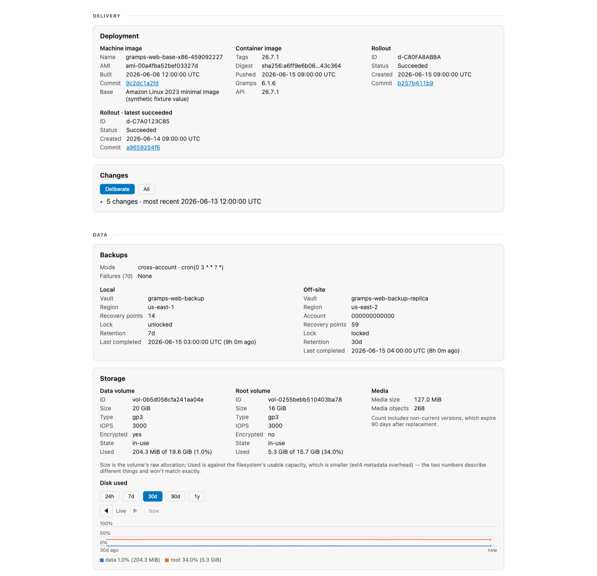
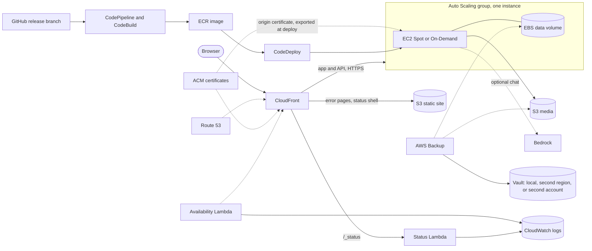

# Gramps Web on AWS

A Terraform module that runs [Gramps Web](https://www.grampsweb.org/), the web app for the Gramps genealogy program, on AWS for a few tens of dollars a month. It is an independent project, unofficial and not affiliated with or endorsed by the Gramps project.

The module serves one shape: a single instance with the database on SQLite on an EBS volume and media in S3. The instance is Spot or On-Demand, behind CloudFront, and backs up locally, to a second region, or to a second AWS account. Optional parts are an AI chat assistant on Amazon Bedrock and an operational [status page](docs/status-page.md), served by [terraform-aws-status-page](https://github.com/kjiwa/terraform-aws-status-page). Gramps Web supports a single API replica, so there is no multi-instance mode.

Required inputs are `primary_domain`, `alert_email`, `repo_url`, and `source_branch`. Everything else has a default; the [module reference](#module-reference) lists them with their costs.



## Architecture



The status page and the availability recorder come from [terraform-aws-status-page](https://github.com/kjiwa/terraform-aws-status-page). The availability Lambda probes the site every minute and records outages and their causes. The status Lambda reads that history, so the page can show uptime and Spot reclaims.

## Cost

Unblended cost by service from AWS Cost Explorer, in USD, for the workload account in us-east-1.

| Service | Sep 2026, measured | Minimal, estimated |
|---|---:|---:|
| EC2 compute (Spot) | 11.94 | 12 |
| Key Management Service | 4.96 | 0 |
| EC2 other (EBS and related) | 3.97 | 3 |
| VPC (public IPv4 address) | 3.61 | 4 |
| Container Registry (ECR) | 1.34 | 1 |
| CloudWatch | 1.30 | 1 |
| Route 53 | 1.04 | 1 |
| Certificate Manager (origin certificate) | 0.00 | 1 |
| S3, Cost Explorer, CodeBuild, Backup | 0.51 | 0 |
| Tax | 2.83 | not included |
| **Total** | **31.50** | **about 23** |

The measured column is one small production deployment for one full month, offered as an example and not a promise: a single Spot instance of about 4 GiB, chat enabled, the status page on, cross-account AWS Backup, two domains, and keel's audit module. The separate backup account is not included; it billed 2.34 that month, mostly KMS. The certificate row reads zero because that deployment had no origin certificate yet. ACM bills 7 USD for an exportable public certificate at issuance and at each renewal, and certificates last 198 days, so it adds about one dollar a month.

The estimated column is computed from the measured one, not measured: the same deployment on Spot with `backup.mode = "disabled"`, no chat, no status page, one domain, and no keel audit or DNSSEC, rounded to whole dollars and before tax. Without backups there is no recovery from data loss, and each Spot reclaim costs a few minutes of outage. On-Demand, the module default, adds about 13 USD a month; the cheapest eligible type, t4g.medium, costs 24.53 USD a month at 0.0336 USD per hour in us-east-1.

No Bedrock line item appeared; chat is billed per token. Spot prices, instance size, volume size, and chat usage move the total. Each cost-bearing input states its price in the [module reference](#module-reference).

The Route 53 line is the two hosted zones from keel's `dns` module, and keel's audit module adds KMS keys, S3 storage, and CloudTrail to the KMS and S3 lines. This module's own keys are one for backups, plus one for the data volume under `cross_account` or a replica key under `cross_region`.

## Backups

AWS Backup snapshots the data volume and the media bucket daily (`backup.schedule`). `backup.mode` picks where the recovery points go.

| Mode | Copy | Protects against |
|---|---|---|
| `local` | None. Recovery points stay in a vault in the same account and region. | Corruption, a bad upgrade, or accidental deletion of data. |
| `cross_region` | A second vault and key in `backup.region`. | Loss of the primary region. |
| `cross_account` | A vault owned by a separate AWS account (`backup.account_id`). | Loss or compromise of the workload account, including deletion of its backups. The destination vault can be locked so that nobody can delete recovery points. |
| `disabled` | No backups. | Nothing. |

Procedures: [cross-account backup](docs/cross-account-backup.md), [restore](docs/restore.md).

## Upgrading Gramps Web

Read the [upstream release notes](https://github.com/gramps-project/gramps-web/releases) for every version you skip. If a release changes the Gramps Web API or database schema, take an app-consistent `scripts/backup.sh --root <root> snapshot` first and delete it once the new version has settled. Then set `gramps.version` to the upstream image tag, apply, and deploy:

```hcl
gramps = {
  version = "26.11.2"
}
```

```sh
terraform apply
scripts/deploy.sh --root <root> gramps
```

The deploy builds the image from the upstream release plus your addons, pushes it to ECR, and rolls it out with CodeDeploy. Expect a brief interruption while the container swaps. Instances pull the image from ECR by digest, so the base AMI needs no rebuild; its pre-pulled image only shortens a cold boot, and the build that follows a push of the new tag refreshes it ([Base AMI](#base-ami)).

To roll back, set the previous version, apply, and deploy. Restore the snapshot ([restore](docs/restore.md)) only if the new version migrated the database.

## Base AMI

The launch templates boot a Packer-built image, `gramps-web-base`: Amazon Linux 2023, Docker, the agents, the watchdogs and the images valkey, nginx and Gramps Web pre-pulled. `dnf-automatic` applies security updates to a running instance (no reboot), so an instance that lives for weeks stays patched between rebuilds.

**Build.** The `gramps-web-ami` CodeBuild project builds both architectures weekly (Sundays 06:00 UTC) and when the app image for `gramps.version` is pushed to ECR, that is, on a deploy. `ami_auto_build = false` leaves builds to `aws codebuild start-build --project-name gramps-web-ami`. Before the snapshot, Packer runs `build/ami/smoke.sh` on the builder: docker is active, the compose file's pinned images and the `gramps.version` image are present, the baked scripts and units are installed and enabled, and `dnf-automatic` is set to security updates. It does not boot the finished AMI, so cloud-init, the volume attach and the app starting are first tested by the first launch. A failed check leaves no AMI, and the `gramps-web-ami-failed` alarm notifies. A build runs about ten minutes; a bump of `gramps.version` is baked once the deploy has pushed the image, and a build before then fails the check. Packer reaches the builder over SSM Session Manager, so no security group admits SSH.

**Adoption.** With `ami_ids` null, a build that passed ends with `scripts/adopt-amis.sh`. It writes a new launch template version per architecture that differs from the latest only in `ImageId`, repins the Auto Scaling group to those version numbers (never `$Latest`, so a Terraform template change still starts a refresh), and keeps the newest five versions plus the default and the pinned one. It starts an instance refresh only when a running instance's AMI is older than `ami_max_age_days` (14); a younger instance picks the new AMI up at its next replacement, which on Spot is usually within days. The refresh uses the group's preferences and its alarm, and replaces the only instance, with an outage of minutes ([module reference](#module-reference)). Nothing is touched while a refresh runs or the refresh alarm is in ALARM. The build publishes `GrampsWeb` `AmiAgeDays`, the age of the oldest running AMI; the `gramps-web-ami-age` alarm fires at twice `ami_max_age_days`.

Terraform seeds `image_id` when it creates a launch template and ignores it afterwards, so a plan never reverts an adopted AMI. After the upgrade to 1.8 the templates keep the AMIs they already have until the first build adopts a newer one.

**Pin.** `ami_ids` holds the AMIs: changing it replaces the launch templates and starts a refresh, and while it is set the automatic builds and the adoption stop. Candidates, newest first:

```sh
aws ec2 describe-images --owners self \
  --filters Name=tag:Name,Values=gramps-web-base Name=state,Values=available \
  --query 'reverse(sort_by(Images,&CreationDate))[].[Architecture,ImageId,CreationDate]' \
  --output text
```

**Roll back.** Repin the group to an older template version, then refresh. Take the version numbers from `aws ec2 describe-launch-template-versions` for each template (`launch_template_ids` output, one per architecture) and keep the group's other settings:

```sh
aws autoscaling describe-auto-scaling-groups --auto-scaling-group-names gramps-web \
  --query 'AutoScalingGroups[0].MixedInstancesPolicy' > policy.json
# edit policy.json: set each LaunchTemplateSpecification's Version, drop LaunchTemplateName
aws autoscaling update-auto-scaling-group --auto-scaling-group-name gramps-web \
  --mixed-instances-policy file://policy.json
aws autoscaling start-instance-refresh --auto-scaling-group-name gramps-web \
  --preferences '{"MinHealthyPercentage":0}'
```

A template the group is pinned behind is held: later builds still write its versions but leave its pin alone, log `HELD`, publish `AmiAdoptionHeld` and raise the `gramps-web-ami-held` alarm, while the other architecture is adopted normally. Repin to the latest version, or apply Terraform after a template change, to resume. `clean-amis.sh` keeps every AMI a template version references, so versions kept by `adopt-amis.sh` stay available.

## Sleeping the site

`active = false` stops the instance and the canary alarms and keeps all data. Public IPv4, KMS keys, the Route 53 zone, ECR, EBS, and the origin certificate keep billing; the `active` input in the [module reference](#module-reference) gives the amount. Setting it back to `true` and applying wakes the site in about five minutes.

## Release branches

CodePipeline and CodeBuild pull `build/` and `scripts/` from `repo_url` on `source_branch`, and CodePipeline can source a branch but not a tag. Pin the module to a tag and set `source_branch` to the matching `release-<major>.<minor>` branch, which moves with patch releases:

```hcl
module "gramps_web" {
  source        = "git::https://github.com/kjiwa/terraform-aws-gramps-web.git?ref=v1.8.0"
  repo_url      = "https://github.com/<you>/terraform-aws-gramps-web"
  source_branch = "release-1.8"
  # ...
}
```

A Dependabot minor or major bump of the module ref also needs `source_branch` moved to the matching release branch.

The builds run that branch's code with deploy permissions, so point `repo_url` at a repository you trust.

## Requirements

- Terraform 1.15 or later, the AWS provider 6.45 or later, and the random provider 3.9 or later. The module needs an `aws.us_east_1` provider alias for the CloudFront certificate.
- A public Route 53 hosted zone for each served domain. [terraform-aws-keel](https://github.com/kjiwa/terraform-aws-keel)'s `dns` module creates one.
- For the first deployment: Packer, to build the base AMIs, a default VPC in the region (Packer sets no subnet), and `aws`, `jq`, `curl`, `unzip`, and `sha256sum` for `build/ami/build.sh`.
- For the operator scripts under `scripts/`: the AWS CLI, `terraform`, and `jq`.
- For the AI assistant (`llm.enabled`): Anthropic model access enabled in the Bedrock console.

## Quickstart

[examples/minimal](examples/minimal) composes the module with keel's DNS, cost budget, and audit modules.

1. Fork this repository: GitHub's CodeConnections app installs only on accounts you control. In the module call, set `repo_url` to your fork and `source_branch` to the release branch matching the module ref (`release-<major>.<minor>`, see [Release branches](#release-branches)). The example takes both as variables, passed below with `-var`.

2. Build the base AMIs from a checkout of this repository. The module looks up the newest AMI tagged `Name=gramps-web-base`, so a plan fails until one exists; `ami_ids` stays unset. The build takes about ten minutes.

   ```sh
   REGION=us-east-1 build/ami/build.sh
   ```

   Use the region the site will run in; the example's `region` variable must match.

3. Create the GitHub connection.

   ```sh
   cd examples/minimal
   terraform init
   terraform apply -target=module.gramps_web.aws_codeconnections_connection.github \
     -var primary_domain=example.org -var alert_email=you@example.org \
     -var repo_url=https://github.com/<you>/terraform-aws-gramps-web -var source_branch=release-1.8
   ```

4. Approve it: in the console, open Developer Tools, Settings, Connections, update the pending `gramps-web` connection, and install the GitHub app on your fork.

5. Apply the rest.

   ```sh
   terraform apply -var primary_domain=example.org -var alert_email=you@example.org \
     -var repo_url=https://github.com/<you>/terraform-aws-gramps-web -var source_branch=release-1.8
   ```

   The first apply in a new account can fail while the Auto Scaling group launches its first instance ("Authentication Failure"); re-running the apply succeeded in testing. The status page at `/_status` is off by default: set `status = { enabled = true }` on the module (`min_role` picks who may view it) after raising the account's Lambda concurrency quota (see the `status` input).

   The apply creates the hosted zone, then waits on certificate validation. Read the name servers with `terraform output -json name_servers` and set them at your registrar while it waits; re-running an apply that timed out is safe. Confirm the SNS subscription emails.

6. Build and ship the app and the error pages. `--root` is the directory that instantiates the module.

   ```sh
   scripts/deploy.sh --root examples/minimal gramps
   scripts/deploy.sh --root examples/minimal web
   ```

## Security and limits

- CloudFront reaches the origin over HTTPS with an ACM exportable certificate for `origin.<primary_domain>`, which the instance exports at deploy time. The origin security group admits only the CloudFront origin-facing prefix list on port 443, which every CloudFront distribution shares, so CloudFront also sends a secret in `X-Origin-Verify` and the proxy answers 403 without it. The secret is a `random_password` in the SSM parameter `/gramps-web/<env>/origin-secret`; the deploy writes it into the proxy's map file, and the app never receives it. On-instance health checks use a loopback-only listener. To rotate, run `terraform apply -replace=module.<name>.module.compute.random_password.origin_secret` and then `scripts/deploy.sh gramps`: requests fail with 403 between CloudFront taking the new value and the deploy.
- CloudFront adds HSTS (one year, no subdomains or preload), `nosniff`, `Referrer-Policy: strict-origin-when-cross-origin`, `X-Frame-Options: SAMEORIGIN` and a `frame-ancestors 'self'` CSP to the app, its static assets and the error pages. The status page and `additional_cache_behaviors` set their own.
- Instance metadata allows a hop limit of 2, so the app containers can read the instance role's credentials (S3 media, Bedrock, SSM parameters, the data volume, the EIP). This is an accepted risk of running the containers on the host's bridge network: any code that runs in the app container is trusted with the role. Narrowing it means giving the containers a role of their own (or a credential proxy) in place of the host role, and is not done here.
- SES starts in the sandbox in a new account. Invite and reset emails reach only verified recipients until you request production access.
- One deployment per account: resource names are fixed, and `env` namespaces only SSM parameters and CodeDeploy.
- `prevent_destroy` on the data volume and media bucket makes `terraform destroy` stop by design; [docs/teardown.md](docs/teardown.md) lists the steps. The audit trail bucket is Object-Locked for a year by default, which blocks teardown of a trial.

## Operating

The operator scripts take the Terraform root that instantiates the module, as `--root DIR` before the subcommand or `GRAMPS_WEB_ROOT`. They read region, account, and resource names from `terraform output -json`, so the root must export the module as one object:

```hcl
output "gramps_web" {
  value = module.gramps_web
}
```

| Script | Purpose |
|---|---|
| `scripts/deploy.sh` | Build and roll out the app (`gramps`) or the error pages (`web`). |
| `scripts/backup.sh` | On-demand snapshot or AWS Backup recovery point, and backup status. |
| `scripts/restore.sh` | Every restore path, and the pre-lock restore drill. |
| `scripts/azmove.sh` | Move or re-key the data volume. |
| `scripts/media.sh` | Reclaim orphaned media objects and normalize media paths. |
| `scripts/clean-amis.sh` | Remove superseded base AMIs. |
| `scripts/adopt-amis.sh` | Point the launch templates at the newest base AMIs; the build runs it. |

Procedures: [cross-account backup](docs/cross-account-backup.md), [restore](docs/restore.md), [AZ move](docs/az-move.md).

## Contributing and security

See [CONTRIBUTING.md](CONTRIBUTING.md) and [SECURITY.md](SECURITY.md). Licensed under the Apache License 2.0.

## Module reference

<!-- BEGIN_TF_DOCS -->
## Requirements

| Name | Version |
| ---- | ------- |
| terraform | >= 1.15 |
| aws | >= 6.45 |

## Resources

| Name | Type |
| ---- | ---- |
| [aws_cloudwatch_metric_alarm.bedrock_tokens](https://registry.terraform.io/providers/hashicorp/aws/latest/docs/resources/cloudwatch_metric_alarm) | resource |
| [aws_cloudwatch_metric_alarm.instance_refresh_pathological](https://registry.terraform.io/providers/hashicorp/aws/latest/docs/resources/cloudwatch_metric_alarm) | resource |
| [aws_codeconnections_connection.github](https://registry.terraform.io/providers/hashicorp/aws/latest/docs/resources/codeconnections_connection) | resource |
| [aws_s3_account_public_access_block.this](https://registry.terraform.io/providers/hashicorp/aws/latest/docs/resources/s3_account_public_access_block) | resource |
| [aws_sns_topic.bedrock_alerts](https://registry.terraform.io/providers/hashicorp/aws/latest/docs/resources/sns_topic) | resource |
| [aws_sns_topic_subscription.bedrock_alerts_email](https://registry.terraform.io/providers/hashicorp/aws/latest/docs/resources/sns_topic_subscription) | resource |
| [aws_ami.base](https://registry.terraform.io/providers/hashicorp/aws/latest/docs/data-sources/ami) | data source |
| [aws_availability_zones.available](https://registry.terraform.io/providers/hashicorp/aws/latest/docs/data-sources/availability_zones) | data source |
| [aws_caller_identity.current](https://registry.terraform.io/providers/hashicorp/aws/latest/docs/data-sources/caller_identity) | data source |
| [aws_region.current](https://registry.terraform.io/providers/hashicorp/aws/latest/docs/data-sources/region) | data source |
| [aws_route53_zone.this](https://registry.terraform.io/providers/hashicorp/aws/latest/docs/data-sources/route53_zone) | data source |

## Inputs

| Name | Description | Type | Default | Required |
| ---- | ----------- | ---- | ------- | :------: |
| alert\_email | Address that receives site DOWN/RECOVERED notices and Spot interruption alerts (string). Confirm the SNS subscription email after the first apply. | `string` | n/a | yes |
| primary\_domain | Canonical apex domain (string). Every other entry in domains, and every www. host, 301s to it. Its Route 53 hosted zone must already exist. | `string` | n/a | yes |
| repo\_url | HTTPS GitHub clone URL of the repo the builds pull build/ and scripts/ from (string). Required: your fork, since the CodeConnections app installs only on accounts you control. | `string` | n/a | yes |
| source\_branch | Branch of repo\_url the builds pull (string). CodePipeline sources a branch, never a tag, so use the release-<major>.<minor> branch matching the module ref. Builds run its build/ and scripts/ with deploy permissions. | `string` | n/a | yes |
| active | Whether the site runs (bool). False sleeps it: zero instances and no canary alarms, all data kept; public IPv4, KMS keys, the hosted zone, ECR, EBS, and the origin certificate still bill (about 10 to 16 USD per month, between the README's estimated and measured Cost columns); waking takes about five minutes. | `bool` | `true` | no |
| additional\_cache\_behaviors | Extra ordered cache behaviors on the primary distribution (list of objects) that route paths to additional\_origins. See modules/edge/variables.tf for the shape and the paths that must not be overlapped. | ```list(object({ path_pattern = string target_origin_id = string allowed_methods = optional(list(string), ["GET", "HEAD"]) cache_policy_id = optional(string, "658327ea-f89d-4fab-a63d-7e88639e58f6") origin_request_policy_id = optional(string) function_associations = optional(list(object({ event_type = string function_arn = string })), []) }))``` | `[]` | no |
| additional\_origins | Extra CloudFront origins on the primary distribution (map of origin ID to object), for serving content beside the app. See modules/edge/variables.tf for the shape. | ```map(object({ domain_name = string origin_access_control_id = optional(string) }))``` | `{}` | no |
| ami\_auto\_build | Build the base AMI weekly and when the app image for gramps.version is pushed (bool). Each build runs CodeBuild for about ten minutes plus two short builder instances and stores one AMI per architecture until superseded (cost unverified: not measured). false leaves builds to aws codebuild start-build. Ignored (no automatic builds) while ami\_ids is set. | `bool` | `true` | no |
| ami\_ids | Base AMI ID per architecture (map with keys arm64 and x86\_64), or null (the default) to seed the launch templates with the newest self-owned AMI tagged Name=gramps-web-base and let each build advance them (README, "Base AMI"). A pin is read when a launch template is created: changing it replaces the templates and starts an instance refresh, and while it is set the builds do not run on their own and nothing is adopted. Rolling back is repinning the Auto Scaling group to an older template version. The AMIs come from the build project this module creates. | `map(string)` | `null` | no |
| ami\_max\_age\_days | Age in days (number, at least 1) beyond which a running instance's AMI makes the build that adopts a newer one start an instance refresh. The refresh replaces the only instance: expect an outage of several minutes (a Spot reclaim measured a median of 180 s; a refresh also waits for the replacement's CodeDeploy hook, unmeasured). Younger instances pick the new AMI up at their next replacement. Builds run weekly, so values under 7 act at the first build past the limit. Ignored while ami\_ids is set. | `number` | `14` | no |
| api | Non-secret Gramps Web API settings (object). registration is open, unlisted (open endpoint, no sign-up link) or closed. tree\_id is required when tree is not main. Unset (null) fields keep upstream defaults. extra passes other upstream keys without the GRAMPSWEB\_ prefix and is stored in a plain SSM parameter, so never put secrets in it. | ```object({ tree = optional(string, "main") tree_id = optional(string) registration = optional(string, "open") disable_telemetry = optional(bool, false) pillow_max_image_pixels = optional(number) max_thumbnail_file_bytes = optional(number) log_level = optional(string) rate_limit_media_archive = optional(string) cors_origins = optional(string) extra = optional(map(string), {}) })``` | `{}` | no |
| az | Availability zone of the instance and data volume (string), or null for the region's first available zone. Changing it on a live deployment replaces the volume (docs/az-move.md). | `string` | `null` | no |
| backup | AWS Backup of the data volume and media bucket (object), billed per GiB-month of recovery points. mode is local, cross\_region (adds a copy in region, default us-east-2, with a second vault and key), cross\_account (copies into a vault account\_id owns under dest\_vault\_name; docs/cross-account-backup.md), or disabled. retention\_days is in days (0 for remote\_retention\_days means the same as local); schedule is a cron or rate expression in UTC. | ```object({ mode = optional(string, "local") region = optional(string, "") account_id = optional(string, "") retention_days = optional(number, 7) remote_retention_days = optional(number, 0) dest_vault_name = optional(string, "gramps-web-backup-replica") schedule = optional(string, "cron(0 3 * * ? *)") })``` | `{}` | no |
| cpu\_credits | T-instance CPU credit mode (string): standard caps CPU at baseline, unlimited bursts at extra cost. | `string` | `"standard"` | no |
| data\_volume\_gib | Size of the gp3 data volume in GiB (number), billed per GiB-month. Raising it is in place; lowering it is not (scripts/azmove.sh shrink). | `number` | `5` | no |
| data\_volume\_snapshot\_id | EC2 snapshot ID to create the data volume from (string), or null for an empty volume. First apply only: on a live deployment it plans a refused replace (docs/restore.md). | `string` | `null` | no |
| dmarc\_rua | mailto: URI for DMARC aggregate reports (string), or empty to omit the rua tag. | `string` | `""` | no |
| domains | Apex domains served (list of strings), or null to serve only primary\_domain. Each needs an existing public Route 53 hosted zone, such as keel's dns module creates. | `list(string)` | `null` | no |
| env | Environment name (string) that namespaces SSM parameter paths and the CodeDeploy deployment group. Fixed resource names mean one deployment per AWS account. | `string` | `"prod"` | no |
| frontend | Gramps Web browser config, window.grampsjsConfig (object). Empty strings keep the upstream default and omit the key. The map style fields are MapLibre style URLs for the light map, dark map and OpenHistoricalMap overlay. | ```object({ hide_dna_link = optional(bool, false) login_redirect = optional(string, "") map_base_style_light = optional(string, "") map_base_style_dark = optional(string, "") map_ohm_style = optional(string, "") })``` | `{}` | no |
| gramps | Gramps Web build (object). version is the upstream grampsweb image tag; base\_image its repository without a tag; addons are addons-source directory names baked in; web\_repo and web\_ref optionally replace the frontend with a fork build (web\_ref pins a commit); addons\_source\_repo is the addons Git URL. | ```object({ version = optional(string, "26.11.2") base_image = optional(string, "ghcr.io/gramps-project/grampsweb") addons = optional(list(string), []) addons_source_repo = optional(string, "https://github.com/gramps-project/addons-source.git") web_repo = optional(string, "") web_ref = optional(string, "") })``` | `{}` | no |
| instance\_requirements | Override of the ASG instance spec (object), or null to derive the spec (2 vCPU, 4 GiB memory floor). See modules/compute/variables.tf for the shape. | ```object({ vcpu_min = number vcpu_max = optional(number, 2) memory_mib_min = number allowed_types_arm64 = list(string) allowed_types_x86_64 = list(string) })``` | `null` | no |
| llm | AI chat assistant on Bedrock (object); off unless enabled, and billed per token when on. model\_id is the Bedrock model or inference-profile ID without the bedrock: prefix; region is the invocation region (empty for the module's region). max\_requests, max\_tokens and max\_context\_length bound each chat run; system\_prompt overrides the agent prompt. hourly\_token\_alarm is the token count per hour that alarms to alert\_email, 0 to disable. | ```object({ enabled = optional(bool, false) model_id = optional(string, "us.anthropic.claude-haiku-4-5-20251001-v1:0") region = optional(string, "") max_requests = optional(number, 15) max_tokens = optional(number, 200000) max_context_length = optional(number, 50000) system_prompt = optional(string, "") hourly_token_alarm = optional(number, 3000000) })``` | `{}` | no |
| media\_bucket\_name | S3 bucket name for media (string, globally unique), or empty to derive gramps-web-media-<account-id>. | `string` | `""` | no |
| monthly\_budget\_usd | Monthly budget in USD (number) that the status page cost panel compares spend against. Set the alerting budget itself in keel's finops module. | `number` | `50` | no |
| rightsize | Scale-back to the cheapest Spot pool (object); off unless schedule is set. schedule is a systemd OnCalendar expression, optionally with a timezone suffix, and applies on the next instance replacement. min\_uptime\_hours is the churn bound between forced replacements. | ```object({ schedule = optional(string) min_uptime_hours = optional(number, 3) })``` | `{}` | no |
| site\_title | Site name shown on error pages (string), or empty to use primary\_domain. | `string` | `""` | no |
| spot | Spot capacity (object). enabled runs Spot only at a fraction of the On-Demand price, and each reclaim costs an outage plus an alert email. Measured on a prod deployment, 2026-10-21 to 2026-11-11: 10 reclaims (about 3 a week), a median outage of 4 minutes, p90 6 minutes, range 2 to 7. allocation\_strategy is price-capacity-optimized, capacity-optimized or lowest-price; rightsize needs lowest-price. | ```object({ enabled = optional(bool, false) allocation_strategy = optional(string, "price-capacity-optimized") })``` | `{}` | no |
| status | Operational status page at /\_status (object); off unless enabled. min\_role is the lowest Gramps Web role that may view it (nobody locks it). host\_metrics adds disk and memory panels and a disk alarm, billed per custom metric and alarm per month. volume\_metrics adds exact byte metrics, needs host\_metrics and a base-AMI rebuild. cost adds a Cost Explorer panel at 0.01 USD per call on a Lambda cold start. public\_reliability serves redacted uptime history at /\_status/public and cannot combine with min\_role nobody. The status Lambda reserves 10 concurrent executions and Lambda keeps 100 unreserved, so the account's Lambda concurrency quota must be at least 110; new accounts often start at 10, so request an increase first. | ```object({ enabled = optional(bool, false) min_role = optional(string, "owner") host_metrics = optional(bool, false) volume_metrics = optional(bool, false) cost = optional(bool, false) public_reliability = optional(bool, false) })``` | `{}` | no |

## Outputs

| Name | Description |
| ---- | ----------- |
| account\_id | AWS account ID the module deploys into. Read by the operator scripts to refuse credentials for another account. |
| ami\_build\_project | AMI CodeBuild project name. Trigger with: aws codebuild start-build --project-name <this>. |
| asg\_name | Auto Scaling Group name. Read by scripts/azmove.sh. |
| backup\_copy\_vault\_arn | Vault each recovery point is copied to (cross\_region: this account, backup region; cross\_account: the backup account). Null when backups stay local or are disabled. Read by scripts/backup.sh and scripts/restore.sh, which also take the destination account and vault name from its ARN. |
| backup\_mode | Backup mode (var.backup.mode: local, cross\_region, cross\_account, or disabled). Read by scripts/restore.sh to refuse restore paths the mode does not support. |
| backup\_region | Region of the off-site backup copy destination; the module's own region when backups stay local or are disabled. Read by scripts/restore.sh. |
| backup\_vault\_name | Local AWS Backup vault the daily plan writes to; null when backup.mode = disabled. Read by scripts/backup.sh and scripts/restore.sh. |
| codeconnections\_arn | Shared GitHub CodeConnections ARN. Approve once (PENDING -> AVAILABLE) before the first build or pipeline run. |
| ebs\_kms\_key\_arn | CMK ARN encrypting the data volume; null unless backup.mode = cross\_account (the only mode that needs one). Read by scripts/azmove.sh rekey. |
| ebs\_volume\_arn | EBS data volume ARN. Read by scripts/backup.sh run and scripts/restore.sh drill, which pass it to `aws backup start-backup-job --resource-arn`. |
| ebs\_volume\_id | EBS data volume ID. Read by scripts/azmove.sh, scripts/backup.sh snapshot, and scripts/restore.sh. |
| ecr\_repository\_url | ECR repository the app image is pushed to and pulled from. |
| eip\_public\_ip | EIP public IP. The CloudFront origin address. |
| env | Environment name (var.env). Read by the operator scripts, which namespace SSM parameter paths with it. |
| gramps\_pipeline\_name | App CodePipeline name. Run by scripts/deploy.sh gramps, which names it as a constant. |
| media\_bucket\_arn | S3 media bucket ARN. Read by scripts/backup.sh run and scripts/restore.sh drill, which pass it to `aws backup start-backup-job --resource-arn`. |
| media\_bucket\_name | S3 media bucket name. Read by scripts/media.sh and scripts/restore.sh drill. |
| primary\_distribution\_arn | CloudFront distribution ARN for the primary site. Scope an additional\_origins S3 bucket policy to it. |
| primary\_distribution\_id | CloudFront distribution ID for the primary site (manual invalidations). |
| primary\_domain | Primary domain the site is served from (var.primary\_domain). Read by scripts/media.sh to reach the app API. |
| region | Region the module deploys into. Read by the operator scripts for every AWS call. |
| status\_url | Authenticated operational status page URL (https://<primary\_domain>/\_status). Requires signing in to Gramps Web at a role >= status.min\_role. Null when status.enabled is false. |
<!-- END_TF_DOCS -->
