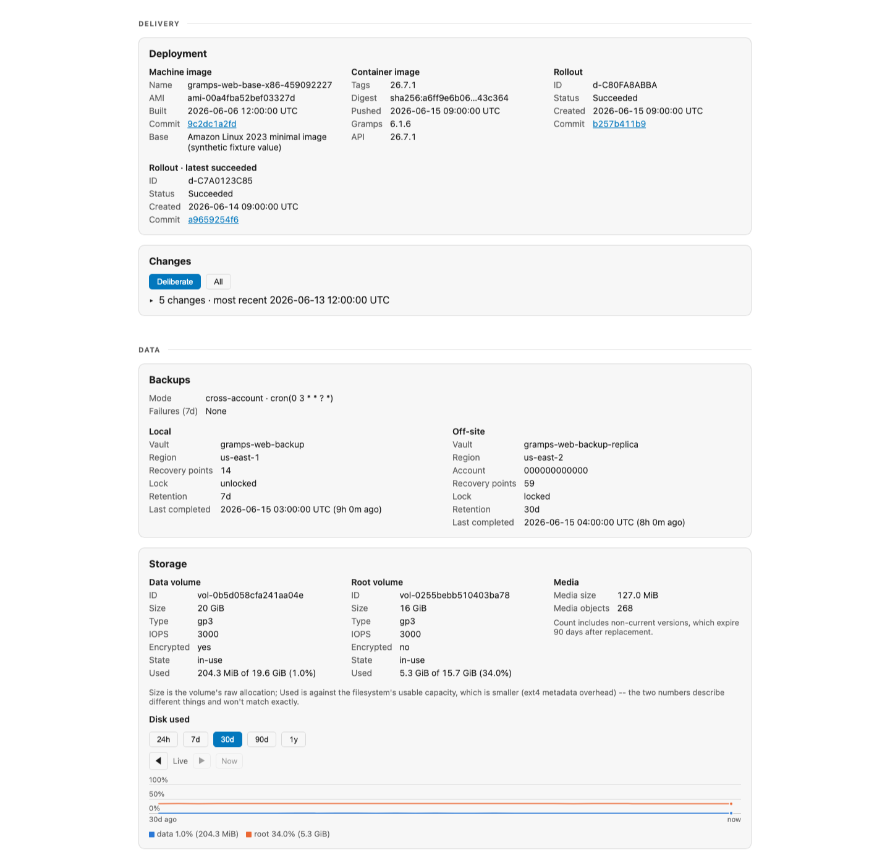
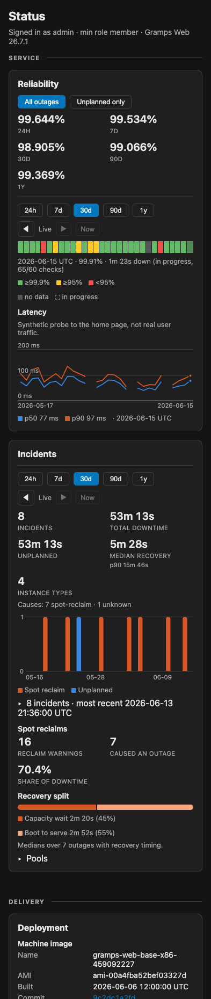

# Status page

Enabled with `status.enabled`. The page, the Lambda API, and the availability recorder come from [terraform-aws-status-page](https://github.com/kjiwa/terraform-aws-status-page) (pinned at v0.1.1); this module configures them for Gramps Web. The page lives at `/_status` on the site: a single-file shell that Terraform uploads to S3, fetching its data from a Lambda behind the same CloudFront distribution. No CodeBuild step publishes it.

What this module supplies:

- `modules/status/plugin/plugin.py`, packaged into the core Lambda. It authenticates a caller by forwarding the token to the site's own `/api/users/-/` and adds a Release panel with the Gramps Web version.
- `modules/status/config.js.tpl`, rendered into the shell's `config.js`: path prefix, the `X-Gramps-Token` header, the Gramps Web token and theme keys in localStorage, the refresh call, the sign-in link, and the disabled panels.
- The `status` input, whose `min_role` sets the lowest Gramps Web role that may view the gated routes.

Panel layout, ranges, the incident and change cards, and the shell's source live in the core repository.

## Public and authenticated routes

| Route | Access | Contents |
|---|---|---|
| `/_status` | The shell is static and open; the page renders what the routes below allow. | |
| `/_status/public` | Unauthenticated; exists only when `status.public_reliability` is true. Cached by CloudFront for up to five minutes. | Uptime ranges, incidents, deliberate changes, Spot warning times. Redacted by allowlist. |
| `/_status/data` | Gramps Web sign-in with a role at or above `status.min_role`. | Everything public, plus host, storage, deployment, backups, the Release panel, and the optional Bedrock, cost, and host-metric panels. |
| `/_status/series` | Same as `/_status/data`. | One panel for a panned time range. |

Authentication forwards the caller's token to the site's own `/api/users/-/` and compares the returned role, so the authenticated routes stop working while the app is down. The public route has no dependency on the app, which is why it still renders during an outage. A panel whose AWS call fails degrades to an error note instead of failing the page, and a degraded public response is cached for ten seconds, not five minutes.

The public route republishes only these fields:

| Section | Fields |
|---|---|
| `incidents` | `started`, `duration_s`, `cause`, `planned` |
| `changes` | `at`, `kind`, `creator`, `outcome`, deliberate changes only |
| `interruptions` | `time` |
| `reliability` | The same payload as the authenticated page |

Instance IDs, instance types, zones, deployment IDs, and descriptions stay private. The cause and the planned flag are disclosed on purpose: they show that production runs on preemptible capacity and is redeployed automatically.

## Data sources

| Source | Written by | Read for |
|---|---|---|
| `SiteUp` and latency metrics | The availability recorder's Lambda probes the site through CloudFront every minute. | Uptime tiles, the strip (a cell's readout names its incidents), latency, and the exact edges of every outage. |
| Episodes log | The availability recorder's Lambda appends one JSON line per completed outage. | Incidents, causes, recovery timing. |
| Change log | The availability recorder's Lambda appends one line per finished CodeDeploy deployment and ASG instance refresh, from EventBridge events. | Changes. |
| Spot interruption log | An EventBridge rule writes every EC2 Spot Interruption Warning to a log group (365-day retention). | Spot reclaim counts. |
| Cause markers | SSM parameters holding `{time, instance_id}`, written by the host watchdogs and `scripts/backup.sh`. | Cause attribution. |
| CodeDeploy and Auto Scaling | Read directly by the status Lambda for the live panels, and by the recorder for cause attribution. | Deployment, host, and the pulled causes below. |

An outage is recorded only when the `site_down` alarm fires, so outages shorter than its threshold (about two minutes) never become an incident. Outage start and end come from the per-minute `SiteUp` series, not from the alarm timestamps. The start is the first failing minute; the end is the first passing minute after the last failing one.

## Incident causes

Each recorded outage carries one cause. Checks run in the order below and the first match wins. The DOWN email states the cause known at that moment; the episode is classified again on recovery, once every marker and AWS record exists, so the stored cause does not depend on timing at alarm time.

A marker matches by when it was written relative to the outage start. A marker written before the app stops matches from 15 minutes before the start to 90 seconds after it. A marker written after the app has stopped matches from 90 seconds before to 15 minutes after. Pulled AWS records match from 10 minutes before the start through the end of the outage.

| Cause | Planned | How it is determined |
|---|---|---|
| `spot-reclaim` | no | An EC2 Spot Interruption Warning was recorded for an instance in the account, written before the app stops. Consumed once attributed, so one warning explains one outage. |
| `rightsize` | yes | The rightsize watchdog (`rightsize.schedule`) wrote its marker while replacing the instance with one from a cheaper pool. Marker written after the app stopped. |
| `health-watchdog` | no | The health watchdog marked the instance Unhealthy after ten consecutive failed local checks, one per minute, and wrote its marker. Marker written after the app stopped. |
| `backup` | yes | `scripts/backup.sh snapshot` wrote its marker just before stopping the app for an app-consistent snapshot. |
| `deploy` | yes | A CodeDeploy deployment for the app and group was created in the window by a person (`user`) or a rollback (`codeDeployRollback`). Deployments created by Auto Scaling for each launched instance are consequences, not causes, and do not match. |
| `instance-refresh` | yes | An ASG instance refresh started in the window. |
| `capacity-change` | yes | An ASG scaling activity in the window whose cause reads "changing the desired capacity". |
| `health-replace` | no | An ASG scaling activity in the window whose cause names a health check, with no watchdog marker to explain it. A Spot reclaim whose warning was missed lands here, because every replacement of an instance marked Unhealthy carries the same wording. |
| `unknown` | no | Nothing matched. |

Waking from sleep is not a cause. The alarm is disabled while the site sleeps, so waking records no incident; it sends a "woke from sleep" email.

The `planned` flag is true for `rightsize`, `deploy`, `instance-refresh`, `capacity-change`, and `backup`. The "Unplanned only" toggle recomputes uptime without planned windows: planned episodes, plus every deliberate CodeDeploy deployment window, including ones too short to trip the alarm.

A change record is marked as having caused an outage when an episode of the same kind overlaps it within 90 seconds. A deployment that overlaps an episode of another cause, or an Auto Scaling launch deployment, is not blamed.
